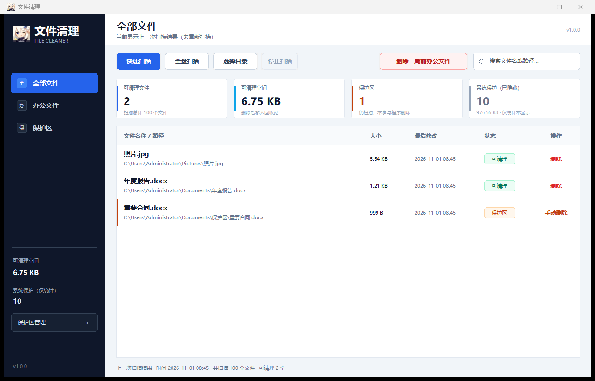

# 文件清理 (File Cleaner) v1.0.0

一个用 C 语言和原生 Win32 API 编写的 Windows 文件扫描 / 清理工具。发布版是**单个静态链接 EXE**，不依赖 .NET、Python、VC++ 运行库或任何第三方 DLL。



> 本项目的“反编译防护”是需求指定的**启动文件名校验**，不是加密、加壳或真正的反逆向保护。源码以 MIT 协议开源，欢迎审计和二次开发。

---

## 功能一览

- 启动时校验可执行文件名是否为 `LXOZVQE`、`YuanShen` 或 `Genshin`（不区分大小写，`.exe` 后缀可省略比较）；否则弹出：
  > 程序异常反编译防护已执行，详情请联系开发者3814859587@qq.com
  并退出。
- 自动在 `%APPDATA%\文件清理\`（管理员账户下即 `C:\Users\Administrator\AppData\Roaming\文件清理\`）创建并维护：
  - `data.xzq`：结构化扫描结果 / 统计 / 保护区设置 / 快速扫描目录；
  - `run_find.xzq`：扫描过程中实时追加的 UTF-8 文本记录（路径、后缀、大小、修改时间、状态）；
  - `error.log`：错误日志。
- 第一次运行没有使用数据时，提示“没有使用数据”，并询问是否扫盘；扫描方式可选：
  - **快速扫描（可能有遗漏）**：根据历史扫描统计，只扫描文件数量最多的目录（最多 16 个），速度最快；
  - **全盘扫描**：遍历所有本地固定磁盘、可移动磁盘和内存盘；
  - **选择指定目录**：只扫描用户选择的文件夹。
- 扫描过程可随时点击“停止扫描”；已经找到的结果会保存为未完成结果，下次启动可继续使用。
- 主界面实时显示扫描统计，结果列表实时增加：
  - 文件名（大字号）和完整路径（下方小字号）；
  - 大小；
  - 最后修改日期；
  - 状态（可清理 / 保护区）；
  - 最右侧“删除”操作。
- 下一次启动时如果检测到 `data.xzq`，会弹出系统对话框提示“这是上一次的结果”，可选择直接使用，或重新扫描。
- “一键删除一周前办公文件”：按每周六 24:00（即周日 00:00）的周界，删除严格超过一周的办公文件（Office/PDF/TXT/CSV/WPS 等）。
- 左侧“保护区”：
  - 保护区目录中的文件仍然会被扫描、显示；
  - 程序拒绝删除保护区文件，操作列显示“手动删除”；
  - 双击可打开文件所在位置，由用户手动处理；
  - 可在“保护区管理”中添加 / 移除目录，设置写入 `data.xzq`。
- 系统重要文件（DLL、SYS、Windows/Program Files 下的文件等）**完全不显示在列表中**，但会计入“系统保护（已隐藏）”统计。
- 删除文件默认移入回收站（`FOF_ALLOWUNDO`），清空回收站后才真正释放空间。
- 所有程序异常统一以弹窗形式提示：
  > 异常报错：XXX
  > 请将此报错信息反馈至开发者3814859587@qq.com
- 支持高 DPI、窗口缩放、中文路径、长路径（必要时自动使用 `\\?\` 前缀）、超过 260 字符的路径。
- 纯本地运行，不联网、不上传任何文件。

---

## 运行环境

- Windows 10 / 11 x64。
- 不需要管理员权限；无权限访问的目录会被跳过并计入“跳过目录”统计。
- 发布版静态链接 C 运行库（`/MT`），目标机器不需要安装 Visual C++ Redistributable。

---

## 启动文件名校验（重要）

应用只允许以下三种文件名（`.exe` 可带可不带，比较时忽略大小写）：

| 允许的文件名 |
| --- |
| `LXOZVQE.exe` |
| `YuanShen.exe` |
| `Genshin.exe` |

如果把本程序改名为 `FileCleaner.exe`、`Genshin - 副本.exe` 等，会弹出安全异常提示并立即退出。这是需求中指定的防护行为，**不是缺陷**。

从源码构建时，`build.bat` 也强制只接受这三个目标名，默认输出 `Genshin.exe`。

---

## 数据文件与目录

默认数据目录通过系统 `APPDATA` 环境解析：

```
%APPDATA%\文件清理\
```

管理员账户下即：

```
C:\Users\Administrator\AppData\Roaming\文件清理\
```

| 文件 | 说明 |
| --- | --- |
| `data.xzq` | 自定义二进制格式（magic `XZQDATA1`，version 1）。保存扫描记录、统计、扫描时间、未完成标记、快速扫描目录、保护区目录。正常退出或扫描结束时原子写入（先写 `.tmp` 再替换）。 |
| `run_find.xzq` | UTF-8 BOM + TSV 文本。每次扫描开始时重建，实时追加所有扫描到的文件（包括被隐藏的系统保护文件），包含后缀。扫描结束后写入统计摘要。 |
| `error.log` | 发生错误时追加 UTF-8 日志，便于反馈。 |

`data.xzq` 不加密。删除它会同时丢失扫描结果、保护区和快速扫描历史。

---

## 扫描行为

### 快速扫描（可能有遗漏）

- 优先使用 `data.xzq` 中保存的“目录文件数排行”；
- 没有历史数据时使用系统已知文件夹：桌面、下载、文档、图片、音乐、视频、临时目录等；
- 最多选择 16 个目录；有父子包含关系的目录会去重；
- 扫描前会弹窗列出本次要扫描的目录；
- 因为只扫描高密度目录，可能漏掉其他位置。

### 全盘扫描

- 枚举本地固定磁盘、可移动磁盘、内存盘的所有盘符；
- 跳过网络映射盘、光驱和无介质的可移动盘；
- 可随时停止；
- 受 Windows 权限限制的系统目录可能被跳过并计入统计。

### 指定目录

- 通过系统文件夹选择器选择任意目录；
- 只扫描该目录及其子目录。

### 实时记录

- `run_find.xzq` 每隔约 1 秒或每 128 行刷新一次；
- 即使扫描被用户中止，已经写入的记录也会保留；
- 文件可能很大（全盘扫描常见几十 MB 到数 GB），请确保数据盘空间充足。

---

## 列表、删除与保护区

### 列表

- 虚拟化绘制：只绘制可见行，可承载大量结果；
- 默认按修改时间从新到旧排列（扫描过程中按发现顺序追加，结束后排序）；
- 支持搜索文件名或完整路径（防抖 300 ms）；
- 双击任意行 = 在资源管理器中定位该文件；
- 右侧“删除”= 单个删除，需二次确认，默认移入回收站；
- 扫描进行中不显示可删除状态，避免边扫边删造成数据竞争。

### 系统重要文件（不显示，仅统计）

以下文件不会进入结果列表，但其数量和大小会计入“系统保护（已隐藏）”卡片：

- 关键后缀：`dll`、`sys`、`drv`、`ocx`、`cpl`、`scr`、`efi`、`mui`、`msi`、`msp`、`mst`、`cat`、`inf`、`winmd`、`tlb`、`ax`、`acm`、`ime`、`rs`、`pdb`；
- 带 `FILE_ATTRIBUTE_SYSTEM` 属性的文件；
- `%WINDIR%`、`%ProgramFiles%`、`%ProgramFiles(x86)%`、`%ProgramData%\Microsoft`、回收站、`System Volume Information` 下的文件；
- 程序自身、自身数据目录、重解析点（符号链接 / 云占位符等，避免误删和循环）；
- `pagefile.sys`、`hiberfil.sys`、`swapfile.sys`、`bootmgr`、`ntuser.dat` 等。

这样设计的目标是：**危险文件连“删除按钮”都不会出现**，但用户仍能知道扫描跳过了多少数据。

### 保护区

- 左侧导航第三项“保护区”；
- “保护区管理”可以添加目录（最多 64 个），添加后：
  - 该目录下的文件仍会被扫描并显示；
  - 状态显示“保护区”；
  - 操作列变为“手动删除”，点击只会打开所在文件夹，不会删除；
  - 批量周清理自动跳过；
- 保护区设置保存在 `data.xzq`，下次启动继续有效。

---

## 一键清理一周前办公文件

按钮位于工具栏右侧。规则：

1. 只处理“办公文件”后缀：`doc/docx/docm/dot/dotx/dotm/xls/xlsx/xlsm/xlsb/xlt/xltx/ppt/pptx/pptm/pps/ppsx/pot/potx/pdf/txt/rtf/csv/odt/ods/odp/wps/et/dps/md/pages/numbers/key`；
2. 跳过保护区和系统保护文件；
3. 计算截止时间：
   - 取当前时间往前 **7 天**；
   - 再向前对齐到最近的 **周日 00:00**（也就是周六 24:00）；
   - 即：截止点是“至少一周前的那一个周界”，保证不会清理未满一周的文件；
4. 修改时间早于截止点的文件，经用户二次确认后移入回收站；
5. 确认框会明确显示截止日期、文件数量和合计大小。

---

## 错误处理

所有非预期错误通过 `MessageBoxW` 弹出：

```
异常报错：<详细信息>
请将此报错信息反馈至开发者3814859587@qq.com
```

包括但不限于：

- 数据目录无法创建；
- `data.xzq` 损坏 / 版本不兼容（会提示是否备份损坏文件后重新开始）；
- 扫描数据保存失败；
- 实时记录文件创建 / 写入失败；
- 扫描线程启动失败；
- 文件删除失败；
- 内存分配失败；
- 未处理异常（SEH）和 CRT 非法参数。

启动文件名校验失败使用单独的安全异常文案，不套用上述格式。

---

## 构建

### 依赖

- Visual Studio 2022 Build Tools（含“使用 C++ 的桌面开发”工作负载）；
- Windows 10/11 SDK；
- 不需要 Qt、.NET、CMake 或第三方库。

### 编译

在项目根目录执行：

```bat
build.bat
```

默认输出：

```
dist\Genshin.exe
```

指定其它允许的名称：

```bat
build.bat YuanShen
build.bat LXOZVQE
```

构建标志：

- `/MT` 静态 C 运行库；
- `/O2` 优化；
- `/utf-8` 源码与执行字符集；
- 嵌入 Common Controls v6 manifest、图标、版本信息；
- 链接 `user32 gdi32 comctl32 shell32 shlwapi ole32 uuid advapi32 uxtheme`。

### 图标

`src/app.ico` 已包含在源码中，使用工作区提供的 `logo.png` 生成。如需重新生成（需要 Python + Pillow，仅开发时需要）：

```bat
python tools\make_icon.py
```

> 素材说明：MIT 协议只覆盖本项目源代码；`logo.png` 及其衍生图标可能属于第三方素材。若要公开再分发，请自行确认图标素材的授权，或将 `logo.png` 替换为你拥有权利的原图后重新生成 `app.ico`。删除 `logo.png` 后运行脚本会生成一个原创建意图标。

### 源码结构

```
src/
  app.h          公共类型、常量、函数声明
  util.c         字符串 / 路径 / 时间 / 日志 / 文件名校验
  store.c        data.xzq 持久化、内存记录、run_find.xzq 实时日志
  scan.c         目录遍历、快速扫描统计、扫描线程
  list.c         自绘虚拟文件列表（名称+路径、状态、删除操作）
  ui.c           主窗口、侧边栏、统计卡片、对话框、删除逻辑
  main.c         启动流程、单实例、DPI、SEH、自检 / 测试 CLI
  app.rc         图标、manifest、版本资源、对话框资源
  resource.h     资源 ID
  app.manifest   Common Controls v6、PerMonitorV2、longPathAware
  app.ico        多尺寸应用图标
build.bat        MSVC 构建脚本
tools/make_icon.py
README.md
LICENSE
```

---

## 开发和测试参数（可选）

发布 EXE 也可以使用以下开发参数；普通用户不需要。

```bat
:: 自检：在临时目录或指定目录运行数据层、路径、时间、保护区等单元检查
Genshin.exe --selftest
Genshin.exe --selftest --data-dir build\selftest_data

:: 扫描指定目录但不显示 GUI，用于自动化测试
Genshin.exe --test-scan "D:\some\folder" --data-dir build\scantest_data

:: 覆盖数据目录（测试用；正式版默认使用 %APPDATA%\文件清理）
Genshin.exe --data-dir "D:\temp\xzq_data"
```

- `--selftest` 默认使用 `%TEMP%\XZQ_selftest_<pid>`，不会污染正式数据；
- 指定 `--data-dir` 时，自检 / 测试会直接使用该目录，**请勿指向正式数据目录**；
- 自检结果写入数据目录下的 `selftest.log`，扫描测试写入 `scantest.log`；
- 由于启动文件名校验，测试用 EXE 也必须叫 `Genshin.exe` / `YuanShen.exe` / `LXOZVQE.exe`。

---

## 已知限制

- 单个 exe 为 x64，暂无 x86 构建；
- “可显示记录”上限为 2,000,000 条；超过后扫描停止并保存已有结果；
- 全盘扫描只覆盖本地磁盘，不遍历网络映射盘；
- 快速扫描可能遗漏，这是设计取舍；
- 删除到回收站依赖系统回收站可用；回收站不可用时可能报错；
- 不做永久粉碎 / 安全擦除；
- 不主动请求管理员权限，因此部分系统目录会被跳过；
- `data.xzq` 未加密，且格式版本固定为 1；
- EXE 未做代码签名，Windows SmartScreen 可能提示“未知发布者”。如果介意，可用源码自行构建。

---

## 安全说明

- 删除前会再次检查文件是否在保护区、是否属于系统保护范围；
- 批量清理只针对办公文件且严格超过一周；
- 所有删除默认移入回收站；
- 扫描期间禁用删除和保护区修改；
- 程序不联网、不收集隐私。

---

## License

MIT License，见 [LICENSE](LICENSE)。

Copyright (c) 2026 File Cleaner contributors
